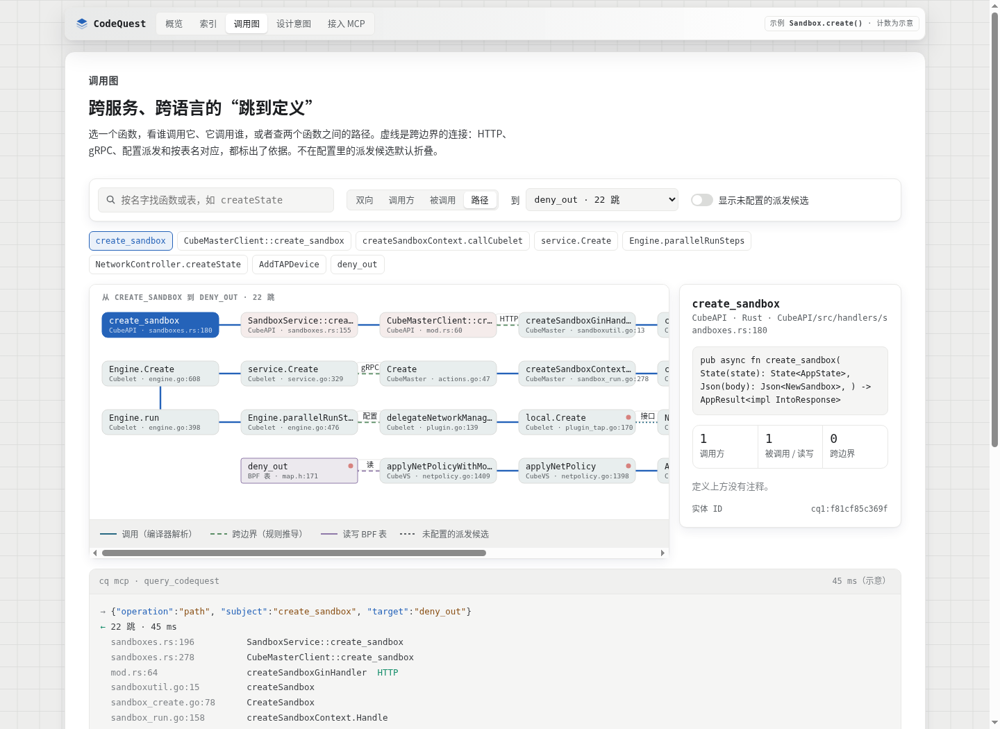

# CodeQuest

CodeQuest 是面向代码仓库的设计理解工具，第一阶段聚焦还原作者对某个功能的完整设计意图。

当前实现以真实编译驱动代码理解，提供 Rust、Go、C/C++ analyst、通用语义模型、文档采集、Ladybug 存储、MCP 和交互 REPL。

它先执行并记录真实构建，再按观察到的配置调用原生语义提供者。查询以模块、符号、发生点和 Body 为基础；作者陈述、推导关系、理解标注与运行观察分别记录来源。结果绑定固定版本，默认分页，保留缺口和继续探索入口。

## 交互演示

**[在线打开 demo1 →](https://akiasprin.github.io/codequest/demo1.html)**

demo1 从 `POST /sandboxes` 追到 eBPF 表，展示 CubeAPI、CubeMaster、Cubelet 和 CubeVS 之间的关系，包含概览、索引、调用图、设计意图和 MCP 五个视图。计数与耗时为示意值，跨边界连接等规划能力在页面中标注。

3D 图从 cdnjs 加载 three.js；离线时显示说明，其余内容仍可使用。

[](https://akiasprin.github.io/codequest/demo1.html)

## 理解架构

文档承载两类理解模块之上的共同设计抽象，表达目标、领域概念、约束、设计理由与整体方案。两个模块分别向下展开同一个功能的实现，形成从设计到实现、再从实现回看设计的双向理解。

```text
文档承载的设计抽象层
目标、领域概念、约束、设计理由与整体方案
├─ 逻辑与数据处理的理解模块
│  ├─ 模块、符号、类型与数据模型
│  └─ 调用、控制与数据流、编译配置、约束与异常路径
└─ 设计与用户体验的理解模块
   ├─ 视觉布局系
   │  └─ 页面版式 → 布局区域 → 内容组织 → 组件与控件
   └─ 动画交互系
      └─ 用户流程 → 状态转换 → 反馈与动画编排 → 具体事件与时序
```

例如，“让用户清楚知道修改了什么，能够逐条取舍，再统一提交”是文档层的整体设计。逻辑与数据处理模块展开草稿保存、丢弃、提交及修订生成；设计与用户体验模块展开草稿区的位置、明细披露、操作流程、提交反馈与动画。两边共同解释这一功能，向上关联同一设计目标。

这里是产品层的理解划分；语言 analyst 为其提供事实。此前 Rust、Go、C/C++ 的工作主要落实逻辑与数据处理模块，JS/TS 中的业务逻辑也属于这一理解范围。crate 的实现依赖见下文“模块边界”。

### 分层披露与理解记忆

分层的目的是控制注意力。默认展示当前问题需要的概览与主要结构，细节按需局部下钻，收起内容保留数量、范围和继续探索入口。图遍历的跳数只是查询参数，不能代替理解层次。

- 逻辑与数据处理从功能协作及模块关系，逐步披露到符号、实现和编译依据；模块与符号是可核实的事实基础，职责与理由的归纳保留其证据和推断性质。
- 视觉布局先按页面排版骨架、区域和内容组织分类，再披露组件及按钮、输入框等控件。视觉单元可以递归分层，默认视野停在布局与区域层。
- 动画交互按用户流程、状态转换、反馈和动画时序组织，与视觉布局系相互关联。一个区域或控件可以同时关联布局约束、交互条件、动画过程和源码。
- 理解记忆围绕同一功能关联设计抽象、布局结构、行为规则和观测证据，记录版本及适用条件。后续变更应能定位受影响的设计单元，并复核相关理解。

作者明确表达的理由、代码中的实现、运行中的观察和人或 LLM 的推断分别记录。由实现还原上层设计时，仍需保留无法确认的部分。以上分层与记忆描述是产品方向，当前落地范围如下。

### 当前实现范围

| 范围 | 当前状态 |
| --- | --- |
| 逻辑与数据处理 | 已有 Rust、Go、C/C++ 的真实构建采集、原生语义事实及查询；覆盖范围由编译配置、提供者能力和显式缺口限定。 |
| 文档处理 | 已有仓库文档、源码注释、rustdoc 等采集、来源关联和检索；文档所承载的统一设计抽象及其与两类实现的对应关系尚未自动还原。 |
| 设计与用户体验 | 视觉布局系、动画交互系及其分层理解属于待落地能力；尚无 JS/TS、React/Vue 等前端语义分析与视觉、交互观测的正式接入。上面的 HTML 演示展示预期的分层理解体验；具体样例与能力边界以页面标注为准。 |

## 构建

当前实现面向 Linux/Unix。**CodeQuest 与 Rust HIR 提供者统一使用 Rust 1.95.0**：workspace 的最低版本为 1.95，仓库通过 `rust-toolchain.toml` 固定到 1.95.0，HIR 安装脚本也使用同一版本。

| 用途 | 前提 |
| --- | --- |
| 构建主程序、外部提供者 | Rust/Cargo、Git、Python 3；推荐用 rustup 管理工具链。安装脚本使用 Python 标准库。 |
| Ladybug / C++ FFI | 支持 **C++20** 的 C/C++ 工具链；**CMake ≥ 3.15** 及 Make 或 Ninja，用于数据库源码构建路径。预编译数据库可减少构建量，FFI 仍需 C++ 编译器。 |
| 分析 Rust | CodeQuest 与 HIR 提供者构建使用 **Rust 1.95.0**；被分析项目仍使用它自己的工具链，并需要对应的 `rust-src`。 |
| 分析 Go | Go；当前验收夹具使用 `go 1.25`，完整本地验收请准备 Go 1.25 或更新版本。 |
| 分析 C/C++ | 项目实际使用的编译器、`compile_commands.json` 及兼容的 libclang；已验证组合为 Clang/libclang 21。 |
| PDF / 开发检查 | PDF 文本提取需要 `pdftotext`；格式和静态检查需要 rustfmt、Clippy。 |

以下命令在仓库根目录执行，显式选择工具链，不改变全局默认版本：

```bash
rustup toolchain install 1.95.0 --profile minimal --component rust-src --component rustfmt --component clippy
cargo +1.95.0 build --release --workspace --locked
RUSTUP_TOOLCHAIN=1.95.0 python3 scripts/setup_rust_hir.py --fetch
```

可选：`python3 scripts/setup_embeddings.py` 下载锁定的 token vectors。缺失时有明确降级，不妨碍先查看演示。

Rust HIR 提供者使用单独固定的 rust-analyzer 源码构建，不进入 core 的 Cargo 依赖；`--fetch` 准备其锁定依赖，不会安装 Rust、CMake 或系统开发包。Go 提供者首次使用时由本机 Go 构建。不同目标项目的 `rust-src`、libclang 查找、辅助二进制及常见报错见 **[安装说明](docs/installation.md)**。

工具缓存位于忽略提交的 `.codequest-tools/`。可分别用 `CQ_RUST_HIR`、`CQ_GO_TYPES`、`CQ_CLANG`、`CQ_TOKEN_VECTORS` 指定已安装的提供者/模型；Rust 也接受 `--hir`。向量模型缺失时明确降级为离线随机索引，不能将其当作预训练语义模型。

## 索引与交互

以下 `/path/to/...` 均由使用者替换。

```bash
target/release/cq index --root /path/to/rust-repo --name demo --store /path/to/state -- cargo check --workspace --all-targets
target/release/cq repl --project demo --store /path/to/state
```

首次阅读可直接使用上面的 demo1 演示。下面是连接自己索引后的 REPL 基本操作；符号及查询结果以实际项目为准：

```text
overview
coverage
help
quit
```

`@N` 是当前会话的实体短句柄。默认每页七项；`expand` 只查询指定节点，`collapse` 保留索引中的事实。任意查询也可提供 JSON 参数，例如：

```text
search {"text":"matched","file":"crates/printer/src/json.rs","kind":"Method"}
trace {"subject":"完整实体ID","depth":5,"include_candidates":true}
```

终端中按 `Ctrl+C`：正在查询时请求取消，空闲时退出；也可输入 `quit` 或按 `Ctrl+D` 退出。活客户端的空闲会话保留固定版本，并为仍有效的会话租约续期。共享 StoreHost 使用独立进程组，一个终端的中断或退出不会终止其他客户端。

交互终端会显示启动阶段、耗时、已就绪状态和 `cq[项目]>` 提示符；慢查询每两秒提示等待时间。提示写入 stderr，stdout 保留 JSON 响应。后台 StoreHost 的启动、慢请求和错误日志保存在 store 目录的 `store-host.log`。

其他语言：

```bash
target/release/cq index --root /path/to/go-repo --language go --name go-demo --store /path/to/state -- go build ./...
target/release/cq index --root /path/to/cxx-repo --language cpp --name cpp-demo --store /path/to/state --compdb /path/to/compile_commands.json
```

C/C++ 会真实重放 compilation database 中的编译命令，包含原有编译输出的写入。应使用项目自己的分析构建目录。索引也会执行项目的 build script、proc macro 或 Go 构建工具。

### 大仓库索引与检索

以下能力当前属于开发实现：已完成构建与局部回归，brocade 的全量索引、发布和查询性能验收尚未完成。首次索引的关系目录采用磁盘分段排序和批量建树；后续增量更新沿用按变更更新的路径。

索引时终端显示当前阶段的进度条，包括已完成数、总数、剩余数、耗时和工作线程数；任务单位随阶段变化（分片、文件、事实、索引项），不会把不同单位相加成总百分比。总量尚未确定时显示“统计中”。相同状态保存在 store 的 `progress/` 目录，重定向输出的工具可读取该状态绘制进度条；设置 `CQ_PROGRESS=off` 可关闭终端绘制。

Rust HIR 复用原生数据库，按编译单元、每片最多 32 个源码文件导出；各片的文件数、字节数和耗时保存在 run 目录的 `hir-export.progress.jsonl` 与 `hir-export.hir-shards/timings.json`。总超时默认为 `900 + 20 × crate 数` 秒，可用正整数环境变量 `CQ_HIR_TIMEOUT_SECS` 覆盖。分片仍共享编译器前端的项目状态，不能据此声称前端内存与项目规模无关。

HIR 分片导出使用同一个 Salsa revision 的只读分析快照并行处理，完成后按分片编号合并，保留符号与引用重映射。默认工作线程数为可用 CPU 数，上限 48；`CQ_HIR_WORKERS=48` 可显式指定（范围 1–48）。实际线程数还受分片数量限制。合并、版本提交等串行阶段会显示 1 个工作线程。

“还原符号与引用”按源文件并行处理，Rust、Go、C/C++ 共用同一套原生导出还原流程。默认使用可用 CPU 数，上限 48；可用 `CQ_NORMALIZE_WORKERS=48` 指定。工作线程自行领取文件编号，并行计算跨文件引用闭包，先生成只包含行号的计划，取得内存额度后直接从共享归档读取所需记录，避免先复制 JSON 再重建。事实在工作线程中编码、校验和写入，按规范键读取；来源和覆盖信息按原文件顺序合并，重复记录仍检查冲突。进度按已合并完成的文件计数，workers 显示线程池大小；另显示活跃任务（规划／还原）、待领取、待准入、待合并数量。活跃表示正在执行任务，不是 CPU 利用率。没有文件完成时也约每 200 ms 更新一次状态。

`CQ_NORMALIZE_INFLIGHT_BYTES` 控制处理中及等待合并的文件工作集估算预算，默认 536870912（512 MiB）。估算采用归档行字节数的八倍，每帧至少 1 MiB，规划中、等待准入、还原中及待合并任务合计不超过线程数两倍。计划可以乱序完成，内存额度按原文件顺序分配，防止后续结果占满预算后阻塞前面的文件；单帧超预算时独占数据还原。它不是整个进程的内存硬上限：共享引用目录、已采集的元数据和工作线程上的轻量行号计划另计。待准入可能在等前序计划或内存额度，不能直接理解为内存耗尽。完成顺序不会改变事实写入顺序，写入失败或线程异常会取消队列。

文档关联按文档需求推进：Rustdoc 保留编译器给出的归属、已解析目标、多候选和未知结果；普通仓库文档先提取显式引用，再集中查找涉及的符号。关联过程按记录类别读取，避免扫描无关事实。进度区分仓库文件读取、文档归属、引用符号查找和链接写入，显示各阶段的实际完成数及总数。

整个磁盘导出流及解析归档的默认预算为 8 GiB，可通过 `CQ_NATIVE_EXPORT_MAX_BYTES` 设置（字节数，最大 16 GiB）；超过预算会保留原始文件并拒绝发布。它与单条事实的 8 MiB 限制分别计算，超大 Value 仍报告原文位置。

原生导出证据与源码采用独立的累计预算，同一证据文件不会挤占后续符号还原的源码额度。`ContentLimit` 会报告内容类别、已用字节、请求字节及上限。若编译和 HIR 导出已完成、后续处理失败，可使用 `index --capture-run RUN_ID --reuse-hir` 在原 store 续跑；要求成功封存的编译记录、完整分片清单和匹配的提供者身份，仍会验证导出结构与源码内容。续跑不表示发生了新的编译；provider 记录会标记复用来源，后续正常刷新不会沿用此选项。

新索引将实体词项、名称三元组、文档三元组和实体向量随 revision 固化；名称查询和文档子串查询先查候选，再用原条件验证。短于三个字符的子串、一般正则仍可能扫描。语义查询默认使用 LSH 近似候选，并返回 `ApproximateVectorCandidates` 缺口；需要穷尽存量向量时传 `"exact_semantic":true`（REPL 可在 JSON 参数中设置）。排名按有界窗口分页，继续查询可能重新扫描候选。近似检索不保证召回率。查询与增量发布必须使用该索引原有的向量模型，换模型需新建索引，不能混合两个模型的向量。

旧 revision 没有这些倒排项时保留原查询路径；增量更新不会把缺项的旧索引冒充新索引。要启用新索引，请在新的 store 目录或新的项目名下重新执行 `index`；可通过 revision 元数据的 `search_index.version` 检查版本。已有旧版 loose objects 继续可读，新发布使用不可变段文件与哈希定位表，减少物理文件数；回收目前释放完全失效的段，部分失效段仍保留。

发布交给 StoreHost 执行，客户端轮询有状态的提交句柄。`CQ_PUBLICATION_WAIT_MS` 控制本次客户端等待时间（默认 120000 毫秒）；超过后正常返回 `publication_in_progress` 和 revision，可用以下命令继续查询，重启后也会检查持久化提交结果。MCP 的 `index_status` 同样刷新发布状态；客户端结束不撤销已开始的提交。

初次索引的排序中间文件使用带校验的 LZ4 帧和精简记录，最终事实页及 Merkle 目录格式保持不变。排序空间按实际同时存在的压缩文件计量，归并期间的新旧文件均计入；每个排序器默认上限 32 GiB，`CQ_INDEX_SCRATCH_BYTES` 可显式设置为 1..1099511627776 字节。预算耗尽会拒绝本次候选，不发布不完整目录。原始记录日志在规范化准备完成后释放；GNU/Linux 上同时归还空闲分配器页，减少后续阶段的文件缓存压力。

```bash
cq query --store /path/to/state --project PROJECT --json \
  '{"operation":"publication_status","revision":"REVISION"}'
```

无条件的节点、关系及种类计数使用固定 revision 的预计算统计；其他 Cypher 仍是显式的全图作业，受 `max_work` 和 `max_job_bytes` 限制。例如按实际记录数和发布清单大小调整 `{"operation":"cypher","text":"...","max_work":10000000,"max_job_bytes":1073741824,"timeout_ms":30000}`，它不会自动变成局部、常量成本查询。

## MCP 与单次查询

MCP 客户端启动命令为 `cq mcp --store /path/to/state`，使用标准 stdio JSON-RPC。`--auto-refresh` 可在服务存活期间观察已索引项目的文件变动；刷新目前重新分析完整声明范围。

```bash
target/release/cq query --project demo --store /path/to/state --json '{"operation":"overview"}'
target/release/cq cypher --project demo --store /path/to/state --text 'MATCH (n) RETURN count(n)'
target/release/cq refresh --project demo --store /path/to/state
```

支持名称/全文/向量/源码搜索、定义与类型导航、成员与大纲、引用/调用/实现、路径/影响、架构统计、文档、覆盖缺口、版本差异、理解标注及运行轨迹导入。MCP 的 `query_codequest` 统一承接查询和 `next` 续查；返回值中的 `hidden` 提供后续入口。`index_repository` 返回后台作业，`index_status` 查询或取消。

## 模块边界

```text
cq-app ────────► cq-core ◄──────── cq-store
  │                 │                │
  └────────────► cq-store             └──► Ladybug / 文件与内容存储

cq-core ───────► cq-capture-protocol ◄── cq-rustc-recorder

外部语义进程：固定版本 Rust HIR / go-types / cq-clang
```

core 包含多语言 analyst、通用模型、语义归一化、文档和查询算法，通过端口使用存储。store 承担日志、冻结内容、物化输入、Ladybug 投影、版本发布、游标与标注持久化。app 负责 CLI、REPL、MCP 和作业调度。

## 验证

```bash
bash scripts/check.sh
python3 scripts/acceptance_native.py --cq "$PWD/target/release/cq" --output /path/to/results
python3 scripts/explore_json.py --cq "$PWD/target/release/cq" --store /path/to/state --project ripgrep --output /path/to/exploration
```

第一条检查格式、编译、依赖边界、自动测试和 Clippy；第二条在临时副本中执行真实多语言编译及 CLI/MCP 验收，不静默跳过缺失提供者。第三条针对已索引的 ripgrep 保存图驱动探索和查询时间记录。

修改原生记录处理时，先运行无需重新编译目标仓库的局部回归，再做真实仓库验收：

```bash
cargo test -p cq-store --test native_streaming --test record_validation --test document_linking --test journal_batch --test production --no-fail-fast
```

默认用例包含从真实 Brocade 导出缩减的 Rust sysroot 跨文件父模块记录，并验证完整编译与部分失败编译的规范化结果一致性。身份与投影按记录种类读取，回归限制非必要全量遍历；缺失父模块在实体集合读取完成后立即报告声明和缺失目标。外部大型导出回放仍需显式提供 `CQ_NATIVE_EXPORTS`，局部回归不能代替全库性能验收。

同一配置下的重复编译观察（例如 build script 的能力探测）保留为独立的代内上下文，并报告 `ObservationScopedCompilationIdentity`；相关声明使用代内句柄，不声称跨版本稳定。非歧义上下文的稳定身份规则保持不变。`fixtures/native/repeated-rust-observations.json` 保留真实探测的三组重复观察；可通过 `cargo run -p cq-store --example audit_compilation_contexts -- /path/to/report.json` 单独回放完整编译元数据、拓扑与规范化准备，避免为检查身份重新运行 HIR。

静态事实覆盖的是实际采集的构建配置。动态派发、回调、宏展开、链接选择和外部输入可能不完整；参数贡献关系不是完整 SSA，静态路径不是实际运行轨迹。作者理由需要直接材料或带证据、可复核的理解标注。PDF 仅处理文本层，未包含 OCR。

语言结构的完整本地验收入口：

```bash
# 首次允许下载 lock 中固定 commit 的仓库及构建依赖。
python3 scripts/check_native.py --output /path/to/native-results --fetch
# 已备妥语料与缓存后省略 --fetch；缺少工具或数据会失败，不会静默跳过。
python3 scripts/check_native.py --output /path/to/native-results
```

该入口依次执行 workspace 检查、release 构建、编译变体/位置/句柄/checkpoint 的基础验收、真实多语言结构查询、原有 CLI/MCP 验收及四个固定版本真实仓库。结构断言同时检查正确目标和错误目标缺席，并保存原生事实、编译证据和公开 MCP 查询。`fixtures/upstream/compiler-graph-go-work` 原样引入 CKG 的 MIT 多模块夹具，来源及 commit 在夹具内；其他语言夹具为独立编译反例。

单独运行和覆盖率测量：

```bash
python3 scripts/test_language_structures.py --output /path/to/structures
python3 scripts/test_foundations.py --output /path/to/foundations
python3 scripts/test_real_corpus.py --output /path/to/corpus-results --fetch
python3 scripts/coverage_native.py --branches --real-corpus --output /path/to/coverage
node scripts/audit_upstream_ckg.mjs --ckg /path/to/ckg-checkout --typescript /path/to/typescript-module --output /path/to/inventory.json
```

覆盖率包含 workspace Rust、真实 CLI/MCP/recorder/clang 查询，排除外部 rust-analyzer 与 Go worker 内部。`--branches` 使用所选 rustc 的实验性分支插桩，仅为子进程设置 `RUSTC_BOOTSTRAP`。静态清单枚举固定 CKG 版本的 TestValidator 调用、带标签的断言 helper 调用与源码决策点；它不是运行覆盖率，也不表示一比一对齐。场景差异登记在 `fixtures/ckg-parity.json`，本轮逐断言记录在 `fixtures/ckg-foundation-assertions.json`；未登记项仍待核对。

Go 默认采集实际 `go build` 选择；显式 `-- test -a -vet=off -run=^$ ./...` 会采集生产、内部及外部测试变体，分别保留编译上下文。C/C++ 保留 declaration、definition、spelling、expansion 四种独立位置。`definition` 等查询接受稳定 `cq1:` 声明句柄，局部变量、参数、body、匿名实体及存在声明冲突的原生键使用 `cqg1:` 代内句柄。

`refresh` 会先重新验证 checkpoint 的源码、编译选择、工具与环境；确认未变化才返回原 revision，并明确标记没有重新观察构建。变化时实际重新编译：Rust 在同一 MCP/REPL 进程内复用 HIR/Salsa 数据库，文本变化交给增量引擎，crate graph 或文件集合变化时重载；C++ 只复用输入和搜索目录均未变化的 TU 语义结果。Go 仍整包分析，最终原生导出与 Ladybug 投影仍完整生成。`query_codequest` 的 `generation` 操作返回图分片 delta；分片增量与原生分析复用是不同指标。build script、proc macro、cgo 或未追踪的 include 查询会保守重建。旧版没有主快照 publication checksum 的索引需要重新运行 `index`。

`trace` 的 `max_work` 同时计入节点访问和边扫描，可在高扇出节点内部暂停后继续。`mode: "types"` 沿类型关系查询；候选实现由 `include_candidates` 显式展开，收起的直接候选会留下数量与继续入口。

对固定 CKG 版本的 9 个参考测试，可用 `scripts/run_ckg_reference.cjs` 单独复跑；需要已构建的上游 checkout，以及独立安装 TypeScript 5.9.3、`@nestia/e2e` 12.1.0 的审计依赖目录。它转译原断言并使用上游库，不会把上游测试的通过算入 CodeQuest：

```bash
node scripts/run_ckg_reference.cjs /path/to/ckg /path/to/audit/node_modules /path/to/reference-results.json /path/to/reference-work
python3 scripts/render_ckg_review.py --evidence /path/to/results --output /path/to/review.html
```

每次索引拥有独立的编译输入累计预算；checkpoint 的派生输出单独计量，当前为每分片 1 GiB、每次发布最多 16 GiB。输入预算保持原有约束，长驻 MCP 的后续刷新不会累计占用前一个分析任务的输入额度。Go 测试变体按规范包名和精确源码集合绑定编译 job；没有独立编译的生产实例明确标为未归属及 Partial。
